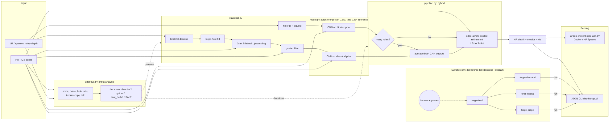

# DepthForge: edge-preserving depth map upsampling (P4)

**Live demo:** `<paste your Cloud Run URL>` · **Code:** `<paste GitHub URL>` · **Team:** `<T01>` · **Problem:** P4

Deploy guide: [`docs/DEPLOY.md`](docs/DEPLOY.md) · Demo script & viva notes: [`docs/VIVA_PREP.md`](docs/VIVA_PREP.md)

DepthForge turns low-resolution, sparse or noisy depth into sharp high-resolution depth at **2×, 4× and 8×**.
It uses the RGB image as a guide and avoids copying RGB texture into the depth.

* **Classical:** adaptive bilateral denoise → large-hole filling → Joint Bilateral Upsampling → colour guided filter → depth-discontinuity detection → boundary snapping
* **Deep:** DepthForge-Net, a 0.5 M-param two-stream residual U-Net with **gated RGB fusion** (anti texture-copy)
* **Hybrid:** an adaptive strategy picked from measured input statistics. The CNN runs on the bicubic prior. When many samples are missing it also runs on the classical JBU prior, and the two outputs are averaged (**dual-path fusion**). At 8× or with holes it adds an edge-aware guided refinement
* **Adaptive:** every input is measured first (noise, holes, texture-copy risk), and filter parameters are derived from those measurements
* **Switchboard UI:** turn any stage on or off and view every intermediate result, live metrics and the parameters chosen for that input
* **Switch agents:** a Switch Console room with four AI agents (lead, classical, neural and judge) that runs experiments from Discord or Telegram, with a human approval step



## Results: NYU Depth V2 (100 unseen test images, standard split)
Trained on NYU train (900) and tuned on NYU val (100). The test images were never seen during training or tuning.

| Clean input, RMSE (m) ↓ | 2× | 4× | 8× |
|---|---|---|---|
| Bicubic | 0.0395 | 0.0561 | 0.0855 |
| Classical (adaptive JBU pipeline) | 0.0366 | 0.0515 | 0.0848 |
| Deep learning (DepthForge-Net) | 0.0249 | 0.0372 | 0.0592 |
| **Hybrid (ours)** | **0.0249** | **0.0372** | **0.0586** |

| Hybrid accuracy | 2× | 4× | 8× |
|---|---|---|---|
| δ<1.25 (standard depth accuracy), clean | 99.98 % | 99.95 % | 99.87 % |
| δ<1.05 (within 5 % of true depth), clean | 99.50 % | 99.09 % | 98.02 % |
| δ<1.05, `hard` (noise + holes + 30 % missing) | 97.52 % | 97.05 % | 95.30 % |

* The hybrid cuts bicubic RMSE by **37 % / 34 % / 31 %** at 2× / 4× / 8× on clean input.
  On `hard` input at 8× the cut is **26 %** (0.133 → 0.098 m).
* The hybrid's adaptive dual-path fusion beats DL-only when many samples are missing (4×/8× hard).
  On clean input the strategy correctly reduces to the CNN alone.
* BF16 inference is 2.5× faster on CPUs with native bfloat16 support for +0.4 % RMSE (`results/optimization.md`).
* Full tables (MAE, PSNR, SSIM, Edge-RMSE, Boundary-F1, latency, memory), the ablation and failure
  cases: `results/eval_P4_T01.md`, `docs/FAILURE_ANALYSIS.md`.

## Quick start

```bash
# 1. One command (Docker)
docker compose up --build            # first time; then `docker compose up` -> http://localhost:7860

# 2. Or plain Python 3.10+
pip install -r requirements.txt
python app.py
```

Three NYU test scenes and three synthetic scenes are bundled (`samples/`), so the app works without any download.

### Reproduce the results
```bash
# train on NYU Depth V2 (GPU ~20 min; see notebooks/train_nyu_colab.ipynb)
python scripts/train.py --data nyu --mat nyu_depth_v2_labeled.mat --minutes 60 --crop 128 --batch 32 --init weights/depthforge_net.pt
# submission evaluation on the unseen NYU test split (images 1000-1448)
python scripts/evaluate.py --data nyu --mat nyu_depth_v2_labeled.mat --n 449 --team T01 --usns "USN1,USN2,USN3,USN4"
# model optimisation study (FP16 / BF16 / pruning)
python scripts/quantize.py
# no dataset? everything also runs on procedural synthetic RGB-D scenes
python scripts/train.py --data synth --minutes 10 && python scripts/evaluate.py --data synth --n 20
pytest -q tests
```

Outputs: `results/eval_P4_T01.md` (submission metrics, first line is the USNs), `results/results.json`,
`results/failures/*.png`, `results/optimization.md`.

### CLI (used by the agents)
```bash
python -m depthforge.cli compare --rgb samples/synthetic_1_rgb.png --depth samples/synthetic_1_depth.png --scale 8
python -m depthforge.cli run --method hybrid --scale 4 --condition hard --off snap --png out.png
python -m depthforge.cli ablate --n 10 --scale 4 --condition hard
```

## Deploy (public URL)
**Google Cloud Run (free tier, recommended):** in Cloud Shell, `git clone` this repo, then run
`gcloud run deploy depthforge --source . --region us-central1 --allow-unauthenticated --cpu 2 --memory 1Gi --max-instances 1 --cpu-boost`.
The image uses ONNX Runtime (no PyTorch), so it is small and needs < 512 MB RAM. Full steps, plus
Render and HF Spaces alternatives, are in [`docs/DEPLOY.md`](docs/DEPLOY.md).

## Using it with Switch (multi-agent lab in your team chat)
1. Install **Docker** and **Switch Console** (https://docs.switchagents.ai/switch-rooms/getting-started), then connect Discord or Telegram.
2. In Console, go to **Templates → Import** and choose `switch/depthforge-lab.template.yaml`. Pick your provider (Claude Code, Codex or OpenCode) and the repo folder.
3. Console creates the room **depthforge-lab** with four agents and posts a kickoff health check.
4. Talk to them in chat, for example:
   * `@forge-lead which stage matters most at 8x on noisy input?` → the judge runs `cli ablate` and posts a ranking
   * `@forge-classical try a wider JBU range sigma on texture-heavy scenes` → before/after numbers, then the judge replies VERIFIED or REJECTED
   * `@forge-neural retrain for 10 min` → the lead posts the command and waits for a human to reply **approve**

Agent rules and the repo map are in `switch/AGENTS.md`.

## Repository layout
```
depthforge/   classical.py adaptive.py model.py pipeline.py metrics.py degrade.py data.py viz.py cli.py
scripts/      train.py evaluate.py quantize.py
switch/       depthforge-lab.template.yaml AGENTS.md
docs/         ARCHITECTURE.md DESIGN.md FAILURE_ANALYSIS.md architecture.png
notebooks/    train_nyu_colab.ipynb
app.py Dockerfile docker-compose.yml requirements.txt tests/
```

## Limitations & ethics
See `docs/DESIGN.md §8` and `docs/FAILURE_ANALYSIS.md`. All reported numbers are on NYU test
images. Synthetic scenes were used only for early development and the smoke-test model (`weights/depthforge_net_synth.pt`).
Uploaded images are processed in memory or temp files and are not stored.
