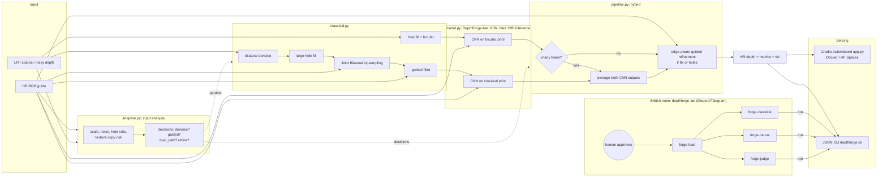

# System architecture

## Code ↔ diagram
| Block | File / function |
|---|---|
| Input analysis | `adaptive.analyze`, `adaptive.choose_params` |
| Denoise | `classical.denoise_depth` |
| Hole fill | `classical.fill_large_holes`, `classical.fill_holes` |
| JBU | `classical.joint_bilateral_upsample` |
| Guided filter | `classical.guided_filter` |
| CNN (tiled inference) | `model.DepthForgeNet`, `pipeline.run_cnn` |
| Hybrid selection / dual-path fusion / refinement | `pipeline.run` (hybrid branch), `adaptive.choose_params` (`dual_path`, `refine`) |
| Discontinuities + snapping (opt-in) | `classical.depth_discontinuities`, `classical.snap_discontinuities` |
| Metrics | `metrics.all_metrics` (RMSE, MAE, PSNR, SSIM, Edge-RMSE, Boundary-F1) + latency/memory in `pipeline.run` |
| Serving | `app.py`, `depthforge/cli.py`, `Dockerfile` |
| Agents | `switch/depthforge-lab.template.yaml`, `switch/AGENTS.md` |
